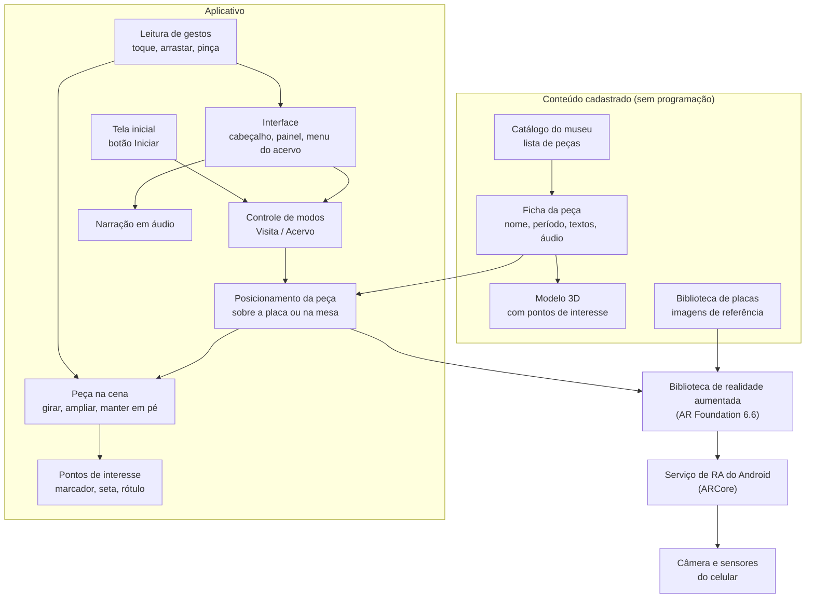
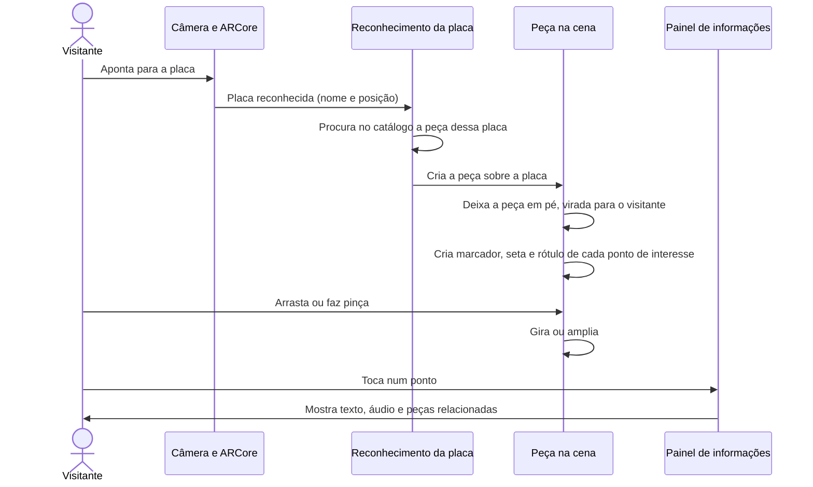
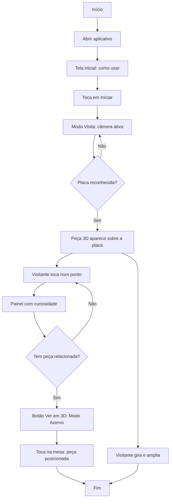
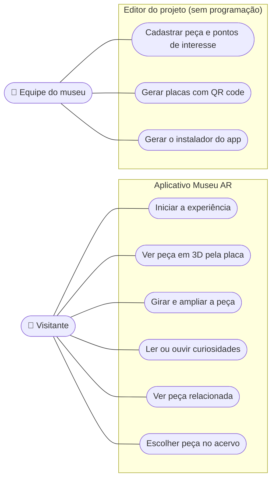

# Museu AR

> **UPX — Realidade Aumentada**  
> Aplicativo de Realidade Aumentada para museus: o visitante aponta o celular para uma placa com QR code e vê, em 3D, a peça que não pode ser manuseada, com setas, textos e curiosidades ancoradas na própria peça.


---

## 1. Identificação do Projeto

| Item | Informação |
|---|---|
| **Projeto** | Museu AR — Realidade Aumentada para museus |
| **Equipe** | Inovar |
| **Curso** | Engenharia da  computação |
| **Disciplina** | UPX — Realidade Aumentada |
| **Professor** | Daniel Ohata |
| **Semestre** | 2026.2 |

### Integrantes

| Nome | RA | Responsabilidade |
|---|---|---|
| Kayke Denelle | *Preencher* | *Preencher* |
| *Preencher* | *Preencher* | *Preencher* |

---

## 2. Visão Geral

O **Museu AR** é um aplicativo Android que usa Realidade Aumentada para mostrar em 3D peças de museu que o visitante não pode tocar.

Ao lado de cada vitrine fica uma **placa com QR code**. O visitante aponta a câmera do app para a placa e a peça aparece em 3D sobre ela. Ele pode **girar** e **ampliar** a peça e tocar em **pontos de interesse** marcados por setas e rótulos. Cada ponto abre um painel com uma curiosidade, um detalhe ou uma técnica. Alguns pontos levam a **peças correlacionadas**, que podem ser vistas em 3D no Modo Acervo.

O app tem dois modos:

| Modo | Como funciona | Para quê |
|---|---|---|
| **Visita** | Aponta a câmera para a placa com QR code da vitrine e a peça aparece sobre a placa. | Ver de todos os ângulos a peça que está atrás do vidro. |
| **Acervo** | Escolhe uma peça num catálogo e a posiciona numa mesa ou no chão. | Ver peças da reserva técnica e peças correlacionadas. |


---

## 3. Problema

- Peças frágeis ficam atrás do vidro: o visitante não vê o verso, o fundo nem os detalhes.
- Grande parte do acervo fica na **reserva técnica** e nunca é exposta.
- As etiquetas das vitrines têm pouco espaço, e o contexto (técnica, uso, curiosidades) fica de fora.
- A relação entre peças (mesmo período, mesmo uso, mesma técnica) raramente é mostrada ao público.

O projeto usa Realidade Aumentada para levar essas informações para a própria peça, no contexto da visita, usando o celular do visitante.

---

## 4. Objetivos

### 4.1 Objetivo Geral

Desenvolver um aplicativo de Realidade Aumentada que reconheça uma placa ao lado da vitrine e apresente a peça em 3D, com informações ancoradas em pontos específicos da peça.

### 4.2 Objetivos Técnicos

- Configurar um projeto Unity 6 com AR Foundation e ARCore.
- Reconhecer placas impressas por **Image Tracking** e posicionar a peça sobre elas.
- Permitir girar e ampliar a peça com gestos (arrastar e pinça).
- Exibir **pontos de interesse** (marcador, seta e rótulo 3D) e um painel com texto e áudio.
- Permitir posicionar peças do catálogo numa superfície (**Plane Detection**).
- Separar conteúdo e código: a equipe do museu cadastra peças sem programar.
- Gerar as placas com QR code automaticamente a partir do catálogo.
- Gerar o APK e testar em um dispositivo Android.
- Documentar instalação, execução, testes e limitações.

---

## 5. Público-Alvo

- **Visitantes de museus** (estudantes, famílias, turistas) que usam o próprio celular durante a visita.
- **Equipes educativas e de curadoria**, que cadastram peças, textos e áudios sem precisar programar.

---

## 6. Funcionalidades

| ID | Funcionalidade | Descrição | Status |
|---|---|---|---|
| RF01 | Reconhecer placa | Reconhece a placa com QR code da vitrine (Image Tracking) | ✅ |
| RF02 | Exibir peça 3D | Mostra a peça em pé, virada para o visitante, sobre a placa | ✅ |
| RF03 | Girar e ampliar | Arrastar gira a peça; pinça amplia ou reduz | ✅ |
| RF04 | Pontos de interesse | Marcador pulsante, seta e rótulo 3D em pontos da peça | ✅ |
| RF05 | Painel de informações | Título, categoria e texto da curiosidade ou da peça | ✅ |
| RF06 | Peças correlacionadas | Botão "Ver em 3D" abre a peça relacionada no Modo Acervo | ✅ (nenhuma relação cadastrada no momento) |
| RF07 | Progresso | Pontos visitados ficam verdes; contador "Descobertas: 2/4" | ✅ |
| RF08 | Modo Acervo | Catálogo com miniaturas; a peça é posicionada numa superfície | ✅ |
| RF09 | Áudio narrado | Tocador com play/pausa e barra de progresso | 🚧 (pronto, faltam os áudios) |
| RF10 | Placas com QR code | Geração automática de uma placa por peça | ✅ |
| RF11 | Link no QR code | QR abrir o site/download do app | 🚧 (hoje contém um identificador) |
| RF12 | Tela inicial | Nome do museu, miniaturas das peças, 3 passos de uso e botão "Iniciar"; a RA só liga depois do toque | ✅ |
| RF13 | Acessibilidade e idiomas | Legendas, tamanho de fonte, PT/EN/ES | ⬜ |

**Legenda:** ✅ Implementado · 🚧 Em desenvolvimento · ⬜ Planejado · ❌ Cancelado

> Os itens ✅ foram verificados no Editor (XR Simulation). O teste em celular ainda não foi feito (ver seção 22).

---

## 7. Requisitos Não Funcionais

| ID | Categoria | Requisito |
|---|---|---|
| RNF01 | Compatibilidade | Android 10 (API 29) ou superior, com suporte a ARCore |
| RNF02 | Desempenho | Modelos 3D com menos de 50 mil triângulos e texturas de até 2K |
| RNF03 | Usabilidade | A interface ocupa as bordas da tela e deixa o centro livre para a peça; layout em retrato |
| RNF04 | Hardware | Câmera traseira e suporte a ARCore (Google Play Services for AR) |
| RNF05 | Manutenção | Peças, textos, pontos e placas cadastrados por *assets*, sem alterar código |
| RNF06 | Documentação | Repositório com instruções para configurar, executar e cadastrar conteúdo |

---

## 8. Tecnologias Utilizadas

| Tecnologia | Versão | Utilização |
|---|---|---|
| Unity | 6000.6.0f1 | Desenvolvimento principal |
| C# | (Unity 6) | Scripts da aplicação e ferramentas de editor |
| AR Foundation | 6.6.2 | Camada de abstração de RA |
| Google ARCore XR Plugin | 6.6.2 | RA no Android |
| Apple ARKit XR Plugin | 6.6.2 | RA no iOS (instalado; build não realizado) |
| XR Plugin Management | 4.7.0 | Gerenciamento dos plugins XR |
| XR Interaction Toolkit | 3.6.0 | Base do template AR Mobile |
| Input System | 1.20.0 | Toque, gestos e atalhos no PC |
| Universal Render Pipeline | 17.6.0 | Renderização |
| uGUI + TextMesh Pro | 2.6.0 | Interface 2D e rótulos 3D |
| Git + Git LFS | 2.x / 3.8 | Controle de versão (arquivos grandes via LFS) |
| GitHub | — | Hospedagem do código e documentação |

---

## 9. Hardware Utilizado

| Equipamento | Modelo | Característica relevante | Utilização |
|---|---|---|---|
| Smartphone | Xiaomi POCO X7 Pro | MediaTek Dimensity 8400-Ultra, tela AMOLED 6,67" 1220x2712, câmera principal de 50 MP, Android 15 (HyperOS 2), RAM *preencher (8 ou 12 GB)* | Execução e testes |
| Computador | Notebook — AMD Ryzen 7 4800H | 16 GB RAM, NVIDIA GeForce GTX 1650, Windows 11 | Desenvolvimento e build |

---

## 10. Arquitetura do Sistema



### Fluxo resumido

```text
Visitante
   ↓
Interface (tela inicial, cabeçalho, painel, barra de modos)
   ↓
Controle da experiência (modos Visita/Acervo, peça na cena)
   ↓
Biblioteca de realidade aumentada (reconhecimento de imagens,
detecção de superfícies, projeção do toque na cena)
   ↓
Serviço de RA do Android (ARCore)
   ↓
Câmera e sensores
   ↓
Placa com QR code ao lado da vitrine
```

---

## 11. Funcionamento da Realidade Aumentada

### 11.1 Técnicas utilizadas

- **Reconhecimento de imagens** (*Image Tracking*, Modo Visita): cada placa impressa está cadastrada na biblioteca `PlacasAR` com o tamanho real (15 cm). A placa tem uma **moldura ilustrada**, rica em cantos e contraste, que o ARCore rastreia, e um **QR code** no centro, legível pela câmera comum do celular.
- **Detecção de superfícies e projeção do toque** (*Plane Detection* e *Raycast*, Modo Acervo): o app detecta superfícies horizontais e posiciona a peça onde o visitante toca.

### 11.2 Fluxo técnico



1. O app inicia a câmera e o rastreamento de imagens.
2. O ARCore compara a imagem da câmera com as placas cadastradas.
3. Quando reconhece uma placa, o app encontra a peça correspondente no catálogo (script `ImageTrackingSpawner`).
4. A peça é criada sobre a placa, **em pé e virada para o visitante** (mesmo com a placa na parede).
5. Cada ponto de interesse do modelo (`HotspotPoint`) vira um marcador, uma seta e um rótulo 3D de tamanho fixo no mundo real.
6. A peça continua visível se a placa sair do enquadramento, para o visitante poder chegar perto e girar.

### 11.3 Elementos virtuais

- modelo 3D da peça;
- marcador pulsante (amarelo → verde depois de visitado);
- seta ligando o rótulo ao ponto;
- rótulo 3D sempre virado para o visitante;
- painel com categoria, título, texto, áudio e peças correlacionadas;
- cabeçalho com nome, período, material e progresso.

---

## 12. Estrutura do Projeto

```text
UPX-ARMOBILE/
│
├── Assets/
│   ├── MuseuAR/
│   │   ├── Data/          catálogo, estilo dos pontos, biblioteca de placas (PlacasAR)
│   │   ├── Scenes/        MuseuAR.unity (cena do app)
│   │   └── Scripts/       código do app e ferramentas de editor
│   ├── Peças/
│   │   ├── Vaso/          modelo, material, objeto pronto (prefab), ficha, placa
│   │   └── Ancient_Paper/ modelo, texturas, objeto pronto (prefab), ficha, placa
│   ├── MobileARTemplateAssets/, Samples/, XR/   (modelo de projeto AR Mobile da Unity)
│   └── Settings/          URP
│
├── Packages/
├── ProjectSettings/
│
├── docs/
│   ├── documents/guia-de-conteudo.md
│   └── images/
│
├── .gitattributes   (arquivos grandes via Git LFS)
├── .gitignore
├── CHANGELOG.md
└── README.md
```

### Pastas principais

| Pasta | Finalidade |
|---|---|
| `Assets/MuseuAR/Scripts` | Scripts produzidos pela equipe |
| `Assets/MuseuAR/Scenes` | Cena do aplicativo |
| `Assets/MuseuAR/Data` | Catálogo, estilo dos pontos de interesse e biblioteca de placas |
| `Assets/Peças` | Uma pasta por peça: modelo, material, prefab, ficha e placa |
| `docs/documents` | Guia de conteúdo (cadastro de peças, placas, testes, APK) |
| `docs/images` | Capturas de tela |

---

## 13. Principais Scripts

| Script | Responsabilidade |
|---|---|
| `Data/MuseumItemData.cs` | Ficha da peça (nome, período, modelo, áudio, placa, correlacionadas) |
| `Data/MuseumCatalog.cs` | Lista de peças e conteúdo do QR code |
| `AR/ImageTrackingSpawner.cs` | Reconhece placas e cria a peça correspondente (Modo Visita) |
| `AR/FreePlacementController.cs` | Posiciona a peça numa superfície detectada (Modo Acervo) |
| `Exhibit/ExhibitController.cs` | Peça na cena: girar, ampliar, manter em pé, pontos visitados |
| `Exhibit/HotspotPoint.cs` | Dados de um ponto de interesse (título, texto, áudio, posição do rótulo) |
| `Exhibit/HotspotView.cs` | Desenha marcador, seta e rótulo 3D |
| `Interaction/TouchInputRouter.cs` | Toque, arrastar e pinça (e mouse no PC) |
| `Interaction/DesktopSimulator.cs` | Atalhos para testar no PC sem celular |
| `Narration/NarrationPlayer.cs` | Toca as narrações em áudio |
| `UI/InfoPanelUI.cs` | Cabeçalho, painel de informações e correlacionadas |
| `UI/CatalogMenuUI.cs` | Menu do acervo com miniaturas |
| `Core/AppModeController.cs` | Troca entre Visita e Acervo e mostra as dicas |
| `Editor/QrCode.cs` | Gerador de QR code (sem dependências externas) |
| `Editor/QrPlateGenerator.cs` | Gera as placas com QR code e registra na biblioteca AR |
| `Editor/MuseuARSceneBuilder.cs` | Monta a cena e a interface |
| `Editor/MuseuARBuild.cs` | Gera o APK Android |

---

## 14. Dependências

```text
com.unity.xr.arfoundation            6.6.2
com.unity.xr.arcore                  6.6.2
com.unity.xr.arkit                   6.6.2
com.unity.xr.management              4.7.0
com.unity.xr.interaction.toolkit     3.6.0
com.unity.inputsystem                1.20.0
com.unity.render-pipelines.universal 17.6.0
com.unity.ugui                       2.6.0   (inclui TextMesh Pro)
```

A lista completa está em `Packages/manifest.json`.

---

## 15. Configuração do Ambiente

### Pré-requisitos

- Windows 10 ou 11;
- Unity Hub com **Unity 6000.6.0f1** e o módulo **Android Build Support** (OpenJDK, Android SDK e NDK);
- **Git** e **Git LFS** (`git lfs install`);
- celular Android 10+ compatível com ARCore (<https://developers.google.com/ar/devices>).

### Procedimento

1. Instale o Unity Hub e a versão 6000.6.0f1 com Android Build Support.
2. Instale o Git e rode `git lfs install` uma vez.
3. Clone o repositório (seção 16). **Não use "Download ZIP"**: o ZIP não traz as imagens e os modelos guardados no Git LFS.
4. Abra o projeto pelo Unity Hub e aguarde a importação.
5. Abra a cena `Assets/MuseuAR/Scenes/MuseuAR.unity`.

---

## 16. Como Executar

```bash
git lfs install
git clone https://github.com/Kayke-Denelle/UPX-ARMOBILE.git
cd UPX-ARMOBILE
```

### No PC (sem celular)

1. Abra a cena `Assets/MuseuAR/Scenes/MuseuAR.unity`.
2. Na aba **Game**, escolha uma resolução em retrato (ex.: 1080x1920).
3. Clique em **Play** e depois dentro da Game view.
4. Na tela inicial, clique em **Iniciar** (ou aperte **Enter**).
5. Aperte **1** (vaso) ou **2** (documento) para simular o QR code de cada peça. Arraste para girar, use a roda do mouse para ampliar e clique nos pontos.

A lista completa de atalhos está no [guia de conteúdo](docs/documents/guia-de-conteudo.md#4-testando-no-pc-xr-simulation).

### No celular (Android)

1. Menu **Museu AR › 4. Gerar APK (Android)** → `Builds/MuseuAR.apk`.
2. Copie o APK para o celular e instale (permita "instalar apps desconhecidos").
3. Imprima as placas com 15 cm de largura (seção 17).

Alternativa com cabo: ative a *Depuração USB* e use **File › Build Profiles › Build And Run**.

---

## 17. Como Utilizar a Aplicação

1. Imprima a placa da peça com **15 cm de largura**, em papel fosco:

| Peça | Placa |
|---|---|
| Vaso de gargalo longo | `Assets/Peças/Vaso/placa-vaso.png` |
| Documento antigo | `Assets/Peças/Ancient_Paper/placa-papel.png` |

2. Abra o app e autorize a câmera.
3. Na **tela inicial**, toque em **Iniciar**.
4. No **Modo Visita**, aponte para a placa a 30–50 cm.
5. A peça aparece sobre a placa. **Arraste** para girar e faça **pinça** para ampliar.
6. Toque nos **pontos amarelos** para ler as curiosidades. Pontos visitados ficam verdes.
7. No **Modo Acervo** (barra inferior), escolha uma peça no catálogo e toque numa mesa para posicioná-la.


---

## 18. Fluxo de Funcionamento



---

## 19. Caso de Uso



---

## 20. Fluxo de Navegação

```text
Abrir app
    ↓
Tela inicial — nome do museu, peças, 3 passos de uso → [ Iniciar ]
    ↓
Modo Visita: câmera — "Aponte a câmera para o QR code ao lado da peça"
    ↓
Placa reconhecida → Peça 3D + cabeçalho
    ↓
Toque num ponto → Painel de informações
    ↓
"Ver em 3D" → Modo Acervo → toque na mesa → peça posicionada

Barra inferior: [ Visita | Acervo ] alterna os modos a qualquer momento
```

---

## 21. Interface

A interface foi desenhada para celular em pé. O app abre numa **tela inicial** com o nome do museu, as peças do acervo, como usar e o botão **Iniciar**; a câmera e o reconhecimento só começam depois do toque. Na experiência, o cabeçalho fica no topo, os painéis embaixo e o centro da tela livre para a peça. Os painéis encolhem para caber o conteúdo.

| Tela inicial | Modo Visita — vaso |
|---|---|
|  |  |

| Pontos de interesse — documento | Modo Acervo |
|---|---|
|  |  |

> Capturas feitas no Editor da Unity com XR Simulation (resolução 1080x1920). O fundo cinza é a sala simulada.

---

## 22. Testes Técnicos

### 22.1 Testes no Editor (XR Simulation)

| Teste | Procedimento | Resultado esperado | Resultado obtido | Status |
|---|---|---|---|---|
| Compilação | Abrir o projeto na Unity | Sem erros de compilação | Sem erros | ✅ |
| Tela inicial | Play no Editor | Tela aberta com as peças; RA parada (sem reconhecer placas) | Aberta, 2 miniaturas, rastreamento desligado | ✅ |
| Botão Iniciar | Tocar em Iniciar | Tela fecha; Modo Visita e câmera ativos | Fechou; Modo Visita; rastreamento ligado | ✅ |
| Reconhecimento (simulado) | Tecla 1 (vaso) / 2 (documento) | Peça aparece com os pontos | Vaso com 4 pontos exibido | ✅ |
| Pontos de interesse | Tocar num ponto | Painel abre; ponto fica verde; progresso atualiza | "Descobertas: 2/4"; pontos verdes | ✅ |
| Modo Acervo | Trocar para Acervo | Catálogo com as peças e miniaturas | 2 peças exibidas; menu ajusta a altura | ✅ |
| Interface em retrato | Captura 1080x1920 | Peça visível entre cabeçalho e painel | Ver seção 21 | ✅ |
| Leitura dos QR codes | Ler as placas com o leitor ZXing | Conteúdo correto | Todas corretas, também reduzidas a 256 px | ✅ |
| QR com links longos | Gerar e ler textos de 24 a 138 caracteres | Conteúdo idêntico | 4/4 idênticos (versões 2 a 8) | ✅ |
| Build Android | Menu "4. Gerar APK" | APK gerado sem erros | `MuseuAR.apk` 1.1.0 (42 MB) em 7 min 58 s; 3 erros de compilação de shader por falta de memória no PC (variantes não usadas pelo app) | 🚧 |

### 22.2 Testes no celular — Xiaomi POCO X7 Pro

> ⚠️ **Dados simulados (mock).** Os resultados desta tabela são **ilustrativos** e ainda **não foram medidos** no aparelho. Eles servem de roteiro de teste e devem ser **substituídos pelos resultados reais** (e o marcador 🧪 trocado por ✅, 🚧 ou ❌) antes da entrega.

**Condições previstas:** APK versão 1.1.0 · placas impressas com 15 cm em papel fosco · sala com luz ambiente · celular na mão, em pé.

| ID | Teste | Procedimento | Resultado esperado | Resultado obtido | Status |
|---|---|---|---|---|---|
| C01 | Instalação | Instalar `MuseuAR.apk` (1.1.0) | App instala e abre | Instalado; pediu permissão de câmera na primeira abertura | 🧪 |
| C02 | Serviço de RA | Primeira abertura do app | Google Play Services for AR disponível | Serviço já instalado e atualizado | 🧪 |
| C03 | Tela inicial | Abrir o app | Tela inicial com as 2 peças e botão Iniciar | Exibida em ~2 s | 🧪 |
| C04 | Reconhecimento — vaso | Apontar para `placa-vaso` a ~40 cm | Vaso aparece sobre a placa | Reconhecido em ~1,5 s; peça estável | 🧪 |
| C05 | Reconhecimento — documento | Apontar para `placa-papel` a ~40 cm | Documento aparece sobre a placa | Reconhecido em ~1,8 s; peça estável | 🧪 |
| C06 | Distância | Aproximar e afastar de 20 cm a 1,5 m | Reconhece na faixa de uso | Reconhece de ~25 cm a ~1,2 m | 🧪 |
| C07 | Ângulo | Inclinar o celular em relação à placa | Reconhece com placa inclinada | Reconhece até ~50° de inclinação | 🧪 |
| C08 | Pouca luz | Sala com luz baixa | Reconhece, ainda que mais devagar | Reconhecimento em ~4 s; leve tremor da peça | 🧪 |
| C09 | Placa fora do quadro | Aproximar a câmera da peça | Peça continua visível | Peça mantida na posição | 🧪 |
| C10 | Gestos | Arrastar e fazer pinça | Gira e amplia | Rotação e zoom suaves | 🧪 |
| C11 | Pontos de interesse | Tocar nos 4 pontos do vaso | Painel abre; pontos ficam verdes; "Tudo descoberto! 4/4" | Funcionou nos 4 pontos | 🧪 |
| C11b | Visual dos pontos | Observar marcadores, setas e rótulos | Marcadores amarelos/verdes e setas visíveis (sem cor rosa) | Exibidos corretamente | 🧪 |
| C12 | Modo Acervo | Escolher peça e tocar numa mesa | Superfície detectada; peça posicionada | Mesa detectada em ~3 s; peça posicionada | 🧪 |
| C13 | Desempenho | 5 min de uso contínuo | Sem travamentos | Fluido, sem travamentos; aquecimento leve | 🧪 |
| C14 | Bateria | 10 min de uso contínuo | Consumo aceitável | ~3% de bateria | 🧪 |

**Legenda:** ✅ aprovado · 🚧 parcial · ❌ reprovado · 🧪 dado simulado, a substituir

---

## 23. Dispositivos Testados

| Dispositivo | Sistema | Versão | Resultado |
|---|---|---|---|
| Editor Unity (XR Simulation) | Windows 11 | Unity 6000.6.0f1 | Funcionamento verificado (seção 22.1) |
| Xiaomi POCO X7 Pro | Android 15 (HyperOS 2) | APK 1.1.0 | 🧪 Dados simulados (seção 22.2) — teste real pendente |

---

## 24. Limitações Conhecidas

- **Resultados no celular ainda simulados**: os testes da seção 22.2 (POCO X7 Pro) são dados ilustrativos; reconhecimento, estabilidade e desempenho reais ainda precisam ser medidos.
- Teste previsto em **um único modelo de celular**; outros aparelhos podem ter desempenho diferente.
- **Somente Android**: o ARKit está instalado, mas o build para iPhone exige um Mac com Xcode.
- **Somente celulares compatíveis com ARCore**, com Android 10 ou superior.
- O reconhecimento depende de **boa iluminação**, de placa **fosca** e impressa com **15 cm**.
- O QR code contém um **identificador provisório** (`MUSEUAR:<id>`); o link definitivo ainda não foi definido.
- **Textos provisórios**: vaso e documento têm período "a definir" e curiosidades gerais sobre cerâmica e papel.
- **Sem narrações em áudio**: o tocador está pronto, mas nenhuma peça tem áudio gravado.
- Peças largas (como o documento) exigem que o visitante se afaste ~1 m para ver todos os rótulos.
- Três modelos recebidos não puderam ser usados sem conversão: `Spear_Primitive_2018.max`, `golden pendant.max2011.max` (formato do 3ds Max) e `IGS_File.igs` (CAD).
- As placas são empacotadas dentro do app: mudar uma placa exige gerar o APK de novo.

---

## 25. Evidências de Funcionamento

- Capturas no Editor: seção 21 e pasta [`docs/images`](docs/images).
- Placa gerada: [`Assets/Peças/Vaso/placa-vaso.png`](Assets/Pe%C3%A7as/Vaso/placa-vaso.png).

```markdown
[Assistir demonstração](COLE_AQUI_O_LINK_DO_VIDEO)
```

> Pendente: foto ou vídeo do app rodando no celular, apontado para uma placa impressa.

---

## 26. Repositórios e Recursos

| Recurso | Link |
|---|---|
| Código-fonte | <https://github.com/Kayke-Denelle/UPX-ARMOBILE> |
| Guia de conteúdo | [docs/documents/guia-de-conteudo.md](docs/documents/guia-de-conteudo.md) |
| Histórico de versões | [CHANGELOG.md](CHANGELOG.md) |
| Dispositivos ARCore | <https://developers.google.com/ar/devices> |
| Figma | *Inserir URL* |
| Trello/Jira | *Inserir URL* |
| Vídeo | *Inserir URL* |

---

## 27. Cronograma Técnico

| Atividade | Responsável | Status |
|---|---|---|
| Configuração do projeto (Unity 6, AR Foundation, ARCore) | *Preencher* | ✅ |
| Modo Visita (Image Tracking) e Modo Acervo (planos) | *Preencher* | ✅ |
| Pontos de interesse, painel e correlacionadas | *Preencher* | ✅ |
| Interface compacta para celular | *Preencher* | ✅ |
| Peças reais (vaso e documento) | *Preencher* | ✅ |
| Placas com QR code | *Preencher* | ✅ |
| Build Android (APK) | *Preencher* | ✅ |
| Testes em celular (POCO X7 Pro) | Equipe | 🚧 roteiro pronto, resultados simulados |
| Textos reais e narrações | Equipe | ⬜ |
| Link definitivo do QR code | Equipe | ⬜ |
| Documentação | Equipe | 🚧 |

---

## 28. Controle de Versão

O projeto usa **Git + Git LFS**. Imagens, texturas e modelos 3D (`.png`, `.jpg`, `.fbx`, `.obj`, `.3ds`, `.max`, `.igs`, …) são versionados pelo LFS, configurado em `.gitattributes`.

Histórico principal (detalhes no [CHANGELOG](CHANGELOG.md)):

```text
dbaabcc  Placas com QR code e build Android (APK)
e6cd06f  Interface compacta, vaso e documento antigo no acervo
7c5d48e  Primeiro commit (protótipo: modos Visita/Acervo, pontos de interesse)
c913b38  Check-in inicial (template AR Mobile)
```

Para os próximos commits, a equipe adotará o padrão:

```text
feat: adiciona narração da ânfora
fix: corrige posição do rótulo do vaso
docs: registra teste em dispositivo Android
test: valida placas impressas em iluminação baixa
```

---

## 29. Problemas Encontrados e Soluções

### Problema 1 — Imagens e modelos "sumiram" ao abrir o projeto

**Problema:** sprites, fontes e placas apareciam quebrados na Unity.  
**Causa:** os arquivos no disco eram apenas *ponteiros* do Git LFS (≈130 bytes), não os arquivos reais.  
**Solução:** `git lfs fetch` + `git lfs checkout` restauraram os 91 arquivos. Clonar sempre com Git LFS instalado (nunca pelo ZIP).

### Problema 2 — Trabalho feito na Unity perdido após o commit

**Problema:** alterações feitas na Unity não chegaram ao GitHub.  
**Causa:** a Unity guarda mudanças de cena na memória até salvar; o Git só vê o que está no disco.  
**Solução:** antes de cada commit, **Ctrl+S** e **File › Save Project**.

### Problema 3 — Interface grande demais

**Problema:** painéis cobriam ~75% da tela e escondiam a peça.  
**Causa:** layout em porcentagem da tela; na Game view deitada os painéis se sobrepunham.  
**Solução:** painéis de tamanho fixo presos às bordas, `CanvasScaler` em modo *Expand*, fontes menores e painéis que encolhem conforme o conteúdo.


### Problema 4 — Modelos 3D não importados

**Problema:** dos cinco modelos encontrados, só dois apareceram na Unity.  
**Causa:** `.max` exige o 3ds Max instalado; `.igs` é formato CAD (superfícies, não malha).  
**Solução:** usados os modelos `.obj` e `.3DS`; os demais precisam ser exportados como `.fbx`/`.obj`.

### Problema 5 — QR code como marcador de RA

**Problema:** QR codes puros têm padrão repetitivo e são rastreados de forma instável pelo ARCore.  
**Causa:** o Image Tracking depende de cantos e detalhes únicos.  
**Solução:** placa híbrida: QR no centro (para a câmera comum) e moldura ilustrada única por peça (para o rastreamento). Os QR codes foram validados com o leitor ZXing.

### Problema 6 — Unity fechando e erros de "out of memory"

**Problema:** a Unity fechou sozinha (gerando a pasta `Assets/_Recovery`), reabriu na cena errada e o build 1.1.0 registrou erros de compilação de shader.  
**Causa:** memória do Windows esgotada — arquivo de paginação fixo e pequeno (5,5 GB) para 16 GB de RAM, com a Unity usando mais de 4 GB.  
**Solução:** aumentar o arquivo de paginação (ou deixá-lo gerenciado pelo Windows), fechar outros programas durante o build e gerar o APK de novo para um build sem erros.

---

## 30. Melhorias Futuras

- testar em celulares de entrada e intermediários e ajustar desempenho;
- textos reais com a equipe educativa e narrações em áudio;
- link definitivo no QR code e APK publicado em *Releases*;
- tela inicial e tutorial de uso da placa;
- legendas, tamanho de fonte e idiomas (PT/EN/ES);
- placas com a identidade visual do museu;
- animações (peça "explodida", antes/depois da restauração);
- quiz ou caça ao tesouro com as curiosidades;
- download das peças sob demanda (Addressables) e painel web para editar textos;
- métricas anônimas de peças e curiosidades mais vistas.

---

## 31. Custos e Recursos

| Recurso | Tipo | Custo/Condição |
|---|---|---|
| Unity 6 | Software | Licença Personal (gratuita para uso educacional) |
| AR Foundation / ARCore | Software | Gratuitos |
| Git, Git LFS, GitHub | Software / serviço | Gratuitos (cota LFS do plano gratuito) |
| Modelos 3D | Conteúdo | Obtidos na internet (verificar licença de cada modelo) |
| Impressão das placas | Material | Papel fosco, 15 cm por placa |
| Smartphone Android com ARCore | Hardware | Equipamento da equipe |
| Notebook (Ryzen 7, GTX 1650) | Hardware | Equipamento da equipe |

---

## 32. Licença

Projeto acadêmico desenvolvido para fins educacionais na disciplina de UPX — Realidade Aumentada.

Os modelos 3D de terceiros mantêm as licenças de seus autores. O template AR Mobile e os pacotes da Unity seguem a licença da Unity.

---

## 33. Autores

- **Kayke Denelle** — *Preencher responsabilidade*
- *Preencher demais integrantes*

**Instituição:** UniFacens  
**Disciplina:** UPX — Realidade Aumentada  
**Semestre:** 2026.2

---

## Checklist de Entrega

- [x] Código-fonte atualizado
- [ ] README completamente preenchido (faltam dados da equipe)
- [x] Versões das tecnologias registradas
- [x] Arquitetura apresentada
- [x] Funcionamento da RA explicado
- [x] Estrutura de pastas documentada
- [x] Scripts principais descritos
- [ ] Procedimento de instalação testado (em outro computador)
- [x] Procedimento de execução testado (no Editor)
- [x] Screenshots reais adicionados (Editor)
- [x] Testes registrados
- [ ] Dispositivos testados informados (POCO X7 Pro informado; resultados ainda simulados)
- [x] Limitações conhecidas documentadas
- [ ] Evidência de funcionamento adicionada (vídeo no celular pendente)
- [x] Commits representam a evolução do projeto
